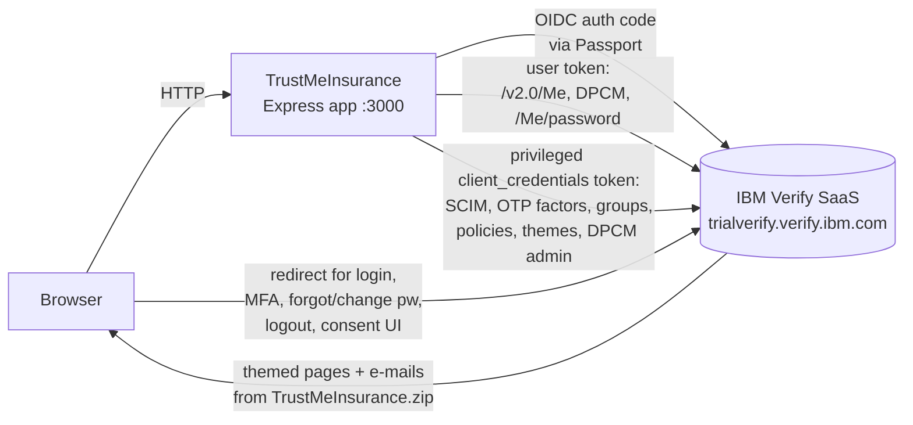

# IBM Verify SaaS + TrustMeInsurance Demo App: Working Playbook

Purpose: a single reference for winning the technical evaluation of the Intact RFP on IBM Verify (SaaS). It covers (A) what Verify SaaS is and can do, (B) how this demo repo works and how to operate it, and (C) the current state of our trial tenant and app, with defects found.

Scope of this document: platform knowledge and repo knowledge only. The 15 Intact use-case feasibility verdicts and the API-driven demo build plans are in [`INTACT-USE-CASE-FEASIBILITY-AND-DEMO-PLAN.md`](INTACT-USE-CASE-FEASIBILITY-AND-DEMO-PLAN.md).

**Evidence labels used throughout**

| Tag | Meaning |
|---|---|
| `[DOCS]` | Stated in the official Verify SaaS documentation hub (https://docs.verify.ibm.com/verify), read in full for ~160 guide pages on 2026-11-05 |
| `[CODE]` | Read directly from this repo's source |
| `[LIVE]` | Observed by calling the trial tenant (`trialverify.verify.ibm.com`) or the running app |
| `[INFER]` | My reasoning. Treat as a hypothesis to confirm in the tenant |

**What I could not do:** I have no admin-console access, so I cannot see what is configured in the tenant (feature flags, existing apps, policies, users). Anything about tenant state below is either `[LIVE]`-probed from the outside or flagged as unknown. The privileged API client in `.env` is still a template placeholder, so I also could not call the management APIs.

---

## Table of contents

1. [Executive summary and blockers](#1-executive-summary-and-blockers)
2. [Verify SaaS: platform knowledge](#2-verify-saas-platform-knowledge)
3. [The demo app: architecture and operation](#3-the-demo-app-architecture-and-operation)
4. [Current environment state and defects](#4-current-environment-state-and-defects)
5. [Operating runbook](#5-operating-runbook)
6. [What the app demonstrates vs. what needs other tooling](#6-what-the-app-demonstrates-vs-what-needs-other-tooling)
7. [Trial-tenant limitations and things to confirm](#7-trial-tenant-limitations-and-things-to-confirm)
8. [Sources](#8-sources)

---

## 1. Executive summary and blockers

### Verify SaaS in one paragraph
IBM Verify is a multi-tenant IDaaS (`<tenant>.verify.ibm.com`) covering workforce SSO, consumer IAM (CIAM), MFA/passwordless, risk-based and adaptive access (Trusteer-backed), a SCIM-based cloud directory, data privacy and consent management (DPCM), a no-code orchestration layer (user forms and Flow designer), identity proofing hooks, branding/themes, provisioning and access-certification governance, and identity threat detection (ITDR). Everything is administered through an admin UI **and** a REST API, and apps integrate through OIDC/OAuth 2.0, SAML 2.0, or direct REST. `[DOCS]`

### The demo app in one paragraph
A Node/Express/Handlebars app ("TrustMeInsurance") that uses Verify as its only identity back end. Login is OIDC via Passport. Registration, password reset, MFA enrolment, profile, consent and delete-account are all done with Verify REST APIs (SCIM, OTP factors, DPCM). It is a **CIAM demo**. It does not exercise workforce SSO, governance, adaptive access, FIDO2, or Flow designer on its own. Those live in the Verify admin console or need extra build. `[CODE]`

### Blockers found: the demo does not currently work end-to-end

| # | Finding | Evidence | Effect | Fix |
|---|---|---|---|---|
| B1 | `API_CLIENT_ID` / `API_SECRET` in `.env` are still the template placeholders | `[LIVE]` Token request returns `invalid_client`. `[CODE]` Values match `dotenv.sample` placeholder pattern | Every privileged call fails: registration, forgot-password, MFA toggle, SMS enrol, delete account, change-password with theme, `/setup`, theme registration, startup lookup of `MFAGROUPID` and `THEME_ID` | Create a privileged API client in Verify (see §5.1) and paste its ID and secret into `.env` |
| B2 | The OIDC client in `.env` rejects the app's redirect URI | `[LIVE]` Hitting `/login` ends on Verify error **CSIAQ0167E** ("redirection URI … does not match any of the OAuth 2.0 Client's pre-registered…"). A made-up client ID instead returns **CSIAQ0154E** ("does not exist"), so the client *exists* and its secret is valid | Nobody can log in | In Verify: Applications → this app → Sign-on → add `http://localhost:3000/oauth/callback` to redirect URIs |
| B3 | `OIDC_CI_BASE_URI` has a trailing slash (`https://trialverify.verify.ibm.com/`) | `[LIVE]` Tenant's discovery document says `issuer = https://trialverify.verify.ibm.com/oidc/endpoint/default`. `[CODE]` `app.js:61` builds `BASE + '/oidc/endpoint/default'`, giving a **double slash**. `passport-openidconnect@0.1.1` rejects the ID token when `claims.iss !== issuer` (`strategy.js:171`) | `[INFER]` Even after B2 is fixed, login will fail at the callback with "ID token not issued by expected OpenID provider" | Remove the trailing slash. `dotenv.sample` has none |

Fix order: B3 → B2 → B1, then restart the app (`.env` is read at startup).

**Already healthy:** `[LIVE]` the tenant's OIDC discovery endpoint responds; the app is running on :3000 (HTTP 200 on `/`); `[LIVE]` the theme ZIP and `public/terms.html` exist; node dependencies resolve.

---

## 2. Verify SaaS: platform knowledge

### 2.1 Tenant model and addressing `[DOCS]`
- Tenant URL pattern `https://<name>.verify.ibm.com`. Vanity domains are supported (via sales).
- **Free trial = 90 days**, all use cases enabled by default, unlimited apps. Trials are created in the **Europe** hosted region unless sales arranges US or China. The trial can be converted to production without losing config.
- Users reach: end-user **Launchpad**, **self-care** (security settings at `/usc/settings/security`), and the **admin console** (`/ui/admin/...`).
- Continuous delivery: features appear without upgrade. Some capabilities are tenant-flagged and must be enabled by IBM (see §7).
- Admin navigation labels shift between releases and between doc pages (e.g. "Authentication → Identity providers" vs "Configuration → Identity sources"). Always confirm the label in *our* tenant.

### 2.2 Capability map

| Domain | What Verify provides | Where configured (per docs) | Main API surface |
|---|---|---|---|
| **Cloud Directory** | SCIM 2.0 user/group store. Users are `regular` (local password, realm `cloudIdentityRealm`) or `federated` (external realm). Custom attributes extend the schema | Directory → Users & groups, Attributes | `/v2.0/Users`, `/v2.0/Groups`, `/v1.0/attributes`, `/v2.0/Schema/attributes`, `/v2.0/CSV/...` |
| **Identity sources** | Cloud Directory, SAML Enterprise, LDAP/AD (via identity agent/bridge), Social (Google, Facebook, LinkedIn, GitHub...), MaaS360. **Realm** = source of a user (`user@realm`) | Configuration → Identity sources | `/v1.0/identitysources` |
| **Identity linking** | Link several external accounts to one primary account (Cloud Directory or SAML Enterprise). Unique ID (e.g. email) + optional just-in-time (JIT) provisioning | Identity source → Identity linking | n/a |
| **SSO** | OIDC and SAML 2.0 for custom apps and a catalog of hundreds of connectors. Verify can act as an authentication broker | Applications → Applications | `/v1.0/applications`, OIDC endpoints |
| **OAuth/OIDC grants** | authorization_code (+PKCE), implicit, password (ROPC), refresh_token, client_credentials, JWT-bearer, device authorization, CIBA, PAR, token exchange, DPoP, cert-bound tokens, and custom `policyauth` | App → Sign-on | `/v1.0/endpoint/default/*` |
| **MFA / factors** | Email, SMS, voice OTP; TOTP; knowledge questions; IBM Verify app (push, biometric); FIDO2/passkeys; QR-code login. **Transient** factors reuse an existing email/phone without enrolment. **Enrolled** factors are registered by the user. **Inline enrolment** forces enrolment when none exists | Security → Authentication factors | `/v2.0/factors/*` |
| **Access policies** | Conditional MFA / allow / deny. Conditions: user and group attributes, geography, IP/network, known device, application context, MDM-managed/compliant device. Actions: allow, MFA always, MFA once per session, block. Rules evaluate top-down. Two types: *federated SSO* and *native application* | Security → Access policies | v5.0 (API ref lists `/v5.0/policyvault/accesspolicy`; one guide shows `/policyvault/v5.0/policyvault/accesspolicy`, so confirm the exact path before scripting). The app calls `/v3.0`, which the docs mark deprecated |
| **Adaptive access (risk-based)** | Trusteer-backed risk score from user, device, activity, environment and behaviour. Action per risk level (Very high / High / Medium / Low). Works in SSO policies and native-app post-auth rules (not pre-auth). Collected through an SDK or a no-code page | Policy → enable Adaptive access. Tenant flag may be required | Adaptive SDK (Web, Android, iOS) |
| **Passwordless** | FIDO2/WebAuthn first factor, QR-code login, passkey autofill in an identifier-first flow | Auth factors, Identity source settings | `/v2.0/factors/fido2/*`, `/v2.0/factors/qr` |
| **Native-app policy auth** | `policyauth` grant. First-contact rules (geo/client type) decide allowed first factors. Post-auth rules decide 2FA. Lets a custom UI stay in control but still be policy-enforced | API client + native policy | Token endpoint, `/v1.0/authnmethods/*` |
| **DPCM (privacy and consent)** | Purposes, attributes, access types, EULAs, privacy rules (condition-driven, e.g. geography), consent types (allow/deny, opt-in/out, transparent), validity period, re-consent on change. Data Usage Approval (DUA) API returns allow / deny / needs-consent | Data privacy & consent | `/dpcm/v1.0/privacy/*`, `/dpcm-mgmt/config/v1.0/privacy/*` |
| **User forms + Registration** | No-code drag-and-drop registration/profile forms, multiple live forms feeding one directory, email-OTP verify, reCAPTCHA v3 human verification, per-form theme | User experience → User forms / User registration | n/a |
| **Flow designer** | Low-code canvas: tasks (User form, Page, Consent, Function (script), Identity proofing, Create user, Redirect, Approvals...) and decision points. Import/export JSON. Trace view for debugging | User experience → Flow designer. **Needs tenant enablement** | Execution URL per flow |
| **Identity proofing** | "Bring your own vendor" via OIDC provider + scripted outgoing/incoming transforms. Outcomes: approve, deny, obligate | Integrations → OIDC providers | n/a |
| **Branding / themes** | HTML/CSS/label templates for login, MFA, consent, notifications, errors, registration. Multiple themes, assigned per app. Import/export is **REST-only** (no UI). Inline MFA, Launchpad and profile pages cannot be themed | User experience → Branding | `/v1.0/branding/themes` |
| **Provisioning / lifecycle** | SCIM outbound to SaaS (Salesforce, M365, Box, Zscaler...) and generic SCIM. Inbound HR (e.g. Aquera). Reconciliation, adoption and remediation policies. AD/LDAP via on-prem provisioning | Application → Provisioning | n/a |
| **Governance** | Access-request workflows (manager/owner approval), **certification campaigns** (user entitlement, group entitlement, account), reviewer delegation, dynamic groups (attribute-based membership) | Applications → Access certification, Dynamic groups | Campaign and dynamic-group APIs |
| **ITDR (threat)** | Edge WAF/bot protection, plus cross-tenant threat detection for credential stuffing, brute force, login deviation, X-Force actionable IPs, compromised/common password checks. Alert and/or block policies | Security → Threat detection. **IBM support must enable** | Threat events report |
| **Events and SIEM** | `/v1.0/events` (max 10,000 per call, `search_after` paging), reports, push webhooks. Guides for Splunk Cloud and ELK | Reports; Integrations | `/v1.0/events`, webhook APIs |
| **On-prem app protection** | **IBM Application Gateway (IAG)**: containerised reverse proxy with built-in OIDC RP. Also works in front of Entra, Okta or Ping IdPs | n/a | n/a |
| **AI/agent tooling** | **Verify MCP Server** (Early Preview): 34 tools (users, groups, apps, MFA, access requests, directory attributes), `admin` and `end_user` personas, usable from IBM Bob or Claude. Watson Assistant chat-bot integration pattern | MCP deploy on Docker/K8s | n/a |
| **Decentralised identity** | Verifiable Credentials: **closed Beta**, request via IBM Support | n/a | n/a |

### 2.3 OIDC and endpoints facts for *our* tenant `[LIVE]`
From `https://trialverify.verify.ibm.com/oidc/endpoint/default/.well-known/openid-configuration`:
- `issuer`: `https://trialverify.verify.ibm.com/oidc/endpoint/default`
- Canonical endpoints are under `/v1.0/endpoint/default/` (`authorize`, `token`, `userinfo`, `introspect`, `revoke`, `jwks`, `device_authorization`, `par`, `ciba`, `rplogout`, `client_registration`). The legacy `/oidc/endpoint/default/...` paths used by the app also work.
- Scopes: `openid profile email phone`. Subject types: public, pairwise.
- Token endpoint auth: `client_secret_basic`, `client_secret_post`, `private_key_jwt`, `client_secret_jwt`.
- Grants advertised: authorization_code, implicit, password, refresh_token, client_credentials, JWT-bearer, `policyauth`, device_code.

### 2.4 Concepts an SMI must be fluent in `[DOCS]`

**Two kinds of API client (very commonly confused)**

| | Application API client | Privileged API client |
|---|---|---|
| Created | Automatically with an OIDC app definition | Manually (Security → API access, or app's API access tab) |
| Authority | **Delegated**: acts as the logged-in user. Needs both app permission *and* user permission | **Its own**: client_credentials grant, no user |
| Use | Self-service: change own password, own consent, own MFA | Pre-login or admin-like work: self-registration, forgot-password, OTP to arbitrary address |
| Risk | Low | High. IBM says use sparingly, least privilege |

The demo app uses **both**: user access token for `/v2.0/Me`, DPCM and `/v2.0/Me/password`. The privileged client is used for everything else. A good talking point for security reviewers is that the app *over-uses* the privileged client, which a production build would narrow.

**Realm.** `userName@realm` is the unique identity. Realm for local users is `cloudIdentityRealm`. Social users get their own realm (e.g. `www.google.com`).

**Access policy types.** *Federated SSO policy* applies to OIDC/SAML apps. *Native application policy* applies to apps using Verify REST directly and has first-contact and post-auth rule sets. Predefined policies (IDs 1–18) are read-only and cannot be set as the tenant default. Copy one into a custom policy first.

**Custom attributes.** Up to 150 mapped to `customAttribute1..150`, plus 10 hashed ones (the docs quote both "150" and "160 total"). Created via UI or `/v1.0/attributes`. The app's setup maps its 9 attributes onto the first free slots.

**DPCM vocabulary.** *Purpose* = why data is used. *Attribute* = what data. *Access type* = what the app may do (`default`, `read`, ...). *EULA* = a special purpose with a terms URL. *Rule* + *default policy* = privacy decision logic. *DUA* = runtime check. *DSP* (data-subject presentation) = text/metadata to render a consent screen. *Consent states*: 1 allow, 2 deny, 3 opt-in, 4 opt-out, 5 transparent (matches `app.js:18`).

**Transient vs enrolled MFA.** Transient: OTP to an address already on the profile or supplied at request time. No enrolment. Enrolled: factor registered by the user (TOTP, FIDO2, Verify app). Inline enrolment prompts when none exist.

**Themes vs flows.** Themes restyle Verify-hosted pages. Flows (Flow designer) change the *sequence* and logic. Flow pages can use custom HTML in a theme's `workflow/pages/` folder (`custom_pageN.html`).

### 2.5 Orchestration assets
IBM publishes importable flows, pages and scripts at https://github.com/IBM-Security/verify-saas-resources. The docs reference these ready-made flows: login with username (JWT-bearer to session exchange), identity-source routing, passkey autofill identifier-first, multi-step registration, registration with account claiming, with identity proofing, with Aadhaar proofing, with risk evaluation (email risk score), registration into a *different* IdP, IAG with Entra/Okta/Ping, LDAP→Okta migration. These are strong reusable demo accelerators.

---

## 3. The demo app: architecture and operation

### 3.1 Stack `[CODE]`
Node (running on v24.7.0 locally), Express 4, `hbs` / `express-handlebars`, `passport` 0.5 + `passport-openidconnect` 0.1.1, `axios` 0.24, `express-session` (memory store), `dotenv`. `qs` is `require`d but not declared in `package.json` (arrives transitively). Start: `npm start` → `node ./bin/www` (port 3000).

### 3.2 Architecture



Two integration styles run side by side:
1. **Redirect (hosted) UX**: login, MFA challenge, forgot password, change password (profile link), logout page, social login. Verify renders the pages using the uploaded theme.
2. **Headless (API-driven) UX**: registration via quote form, OTP flows for forgot-password / recover-username / SMS enrolment, profile read, consent read/write, MFA toggle, delete account. The app renders its own pages and calls Verify.

### 3.3 Repository map

| Path | Role |
|---|---|
| [`app.js`](app.js) | Express bootstrap. Passport OIDC strategy, session, auth middleware, `/login`, `/login-google`, `/login-linkedin`, `/oauth/callback`, `/logout`, Handlebars helpers, and startup lookups of `MFAGROUPID` and `THEME_ID` |
| [`functions.js`](functions.js) | ~45 helpers wrapping Verify REST: token, OTP, SCIM users and groups, policies, application and DPCM provisioning, themes, identity sources |
| [`lib/dpcm/dpcmClient.js`](lib/dpcm/dpcmClient.js) | DPCM client: `performDUA`, `getDSP`, `storeConsents`, `getUserConsents` |
| [`routes/index.js`](routes/index.js) | Home, profile, DPCM post, forgot password, recover username, change password, SMS enrolment, MFA toggle, delete account, download data |
| [`routes/open-account.js`](routes/open-account.js) | Insurance quote flow (car/home) that creates or updates the Verify user |
| [`routes/consent.js`](routes/consent.js) | Consent history and EULA acceptance |
| [`routes/setup.js`](routes/setup.js) | One-click tenant provisioning at `/setup` |
| [`routes/account-claim.js`](routes/account-claim.js) | Account-claim lookup (partial: see §4.3) |
| [`routes/profile.js`](routes/profile.js) | Debug view of tokens/attributes. **Dead code** (see §4.3) |
| `views/insurance/*.hbs` | Active UI. `views/airline`, `bank`, `ecommerce` are **unused** static pages from other demos |
| `ci-theme/` | Verify theme source (596 template files, 13 non-default locales), `TrustMeInsurance.zip`, [`manage-theme.js`](ci-theme/manage-theme.js) CLI, theme READMEs |
| `public/` | Static assets, `terms.html` (the EULA body) |
| [`README.md`](README.md), [`README-Developing.md`](README-Developing.md) | Official setup guide; developer notes mapping each feature to Verify calls |

### 3.4 Configuration (`.env`) `[CODE]`

| Variable | Meaning | Who sets it |
|---|---|---|
| `OIDC_CI_BASE_URI` | Tenant base URL. **No trailing slash** | You |
| `API_CLIENT_ID`, `API_SECRET` | Privileged API client credentials | You (create in Verify) |
| `OIDC_REDIRECT_URI` | Callback URL, default `http://localhost:3000/oauth/callback` | You |
| `OIDC_CLIENT_ID`, `OIDC_CLIENT_SECRET` | The app's OIDC client | `/setup` writes them back to `.env` |
| `ALLOW_DYNAMIC_SETUP` | Enables `/setup` | You |
| `APP_NAME`, `THEME_NAME` | Verify application and theme names (`TrustMeInsurance`) | You |
| `MFAGROUP` | Group whose members get forced MFA (`MFAGroup`) | You |
| `EULA_URL`, `*_PURPOSE_ID`, `READ_ACCESS_TYPE`, `DEFAULT_ACCESS_TYPE`, `EMAIL_ATTRIBUTE_ID` | DPCM objects | defaults are fine |
| `BRAND_ID` | `false`, or a suffix appended to usernames (multi-brand trick) | You |
| `SEND_PRIVACY_SCOPES` | If `true`, adds DPCM scopes to the OIDC request | You |
| `APP_ICON_PATH`, `APP_DESCRIPTION`, `OIDC_APP_URL` | App tile metadata in Verify | You |

Runtime-derived (not in `.env`): `MFAGROUPID`, `THEME_ID` are looked up at startup using the privileged client. They stay empty if B1 is unresolved.

### 3.5 Route inventory

| Route | Auth | Behaviour |
|---|---|---|
| `GET /` | public | Landing page / quote entry |
| `GET /login`, `/login-google`, `/login-linkedin` | public | Start OIDC. Google/LinkedIn pass `login_hint={"realm":"www.google.com"}` to skip the chooser |
| `GET /oauth/callback` | public | OIDC callback → `/app/profile` (or `/open-account` after social login) |
| `GET /logout` | session | Revoke access token, then redirect to Verify's `/idaas/mtfim/sps/idaas/logout?themeId=…` |
| `GET /app/profile` | session* | **Hub page.** Runs a DUA for the EULA (redirects to `/app/consent/terms` if not accepted), reads `/userinfo` and `/v2.0/Me`, derives MFA/linked-accounts/car/quote count, runs DUA for Communications and Paperless |
| `POST /app/dpcm` | session | Writes opt-in (3) / opt-out (4) consents using the **user's** token |
| `POST /app/toggleMfa` | session* | Adds/removes the user from `MFAGroup` (privileged) |
| `GET/POST /app/forgot-password`, `POST /app/forgot-password-verify` | public | App-driven: look up user → email OTP → verify → privileged `passwordResetter` (auto-generated password emailed) |
| `GET/POST /app/recover-username` | public | `/v1.0/usc/username/recovery` with email OTP |
| `GET/POST /app/change-password` | session | `POST /v2.0/Me/password` with the user token (app-hosted form). Profile page also offers a Verify-hosted change-password link |
| `GET/POST /app/enroll/sms`, `POST /app/enroll/sms/verify` | session* | SMS OTP to a phone → on success PATCH `phoneNumbers` onto the user |
| `GET/POST /app/deleteme` | session* | Type your name to confirm → `DELETE /v2.0/Users/{id}` → logout |
| `GET /app/downloadme` | session* | Downloads the session's SCIM profile as JSON (a DSAR-style "download my data") |
| `GET /app/consent` | session | Consent history from `dpcm-mgmt/.../consents` |
| `GET/POST /app/consent/terms` | session | EULA presentation (`getDSP`) and acceptance (state 1/2) |
| `GET /open-account`, `POST /open-account/step-two`, `/car`, `/home` | public (profile-prefilled if logged in) | Quote form. **If the e-mail is new it creates the user** (Verify e-mails a generated password using the themed template). If it exists it PATCHes attributes and increments `quoteCount` |
| `GET/POST /account-claim` | public | Looks up an *inactive* user by `accountId` (custom attribute). **Half-built**: see §4.3 |
| `GET/POST /setup` | public (!) | Automated tenant setup, see §3.7 |
| `GET /app/dashboard` | public | Static "My Account" mock |

\* The route lacks the `checkAuthentication` middleware. It relies on session data, so unauthenticated hits produce errors rather than data (see §4.3).

### 3.6 Key flows, mapped to Verify calls

**Login (OIDC authorization code).** `/login` → Passport redirect to `…/authorize` (scope `openid profile email`, optionally DPCM scopes) → Verify shows the themed `combined_login_selection.html` (Cloud Directory form + social buttons) → access policy evaluated (MFA if user is in `MFAGroup`) → code → app exchanges at `/token` → session holds `accessToken` and `userId`. The app logs tokens and claims to the console.

**Self-registration through a quote.** `open-account` form → `getUserID` (`GET /v2.0/Users?filter=userName eq "<email>"`) → none found → `POST /v2.0/Users?themeId=<THEME_ID>` with SCIM core + IBM extension (custom attributes `birthday`, `carMake/Model/Year`, `homeType`, `ageHome`, `quoteCount`, `brandId`) → Verify sends the themed welcome e-mail with a generated password. This is a pattern worth calling out for RFP: "progressive profiling by transaction" (account is born from a business action, not a registration form).

**MFA opt-in.** Toggle → add/remove user in `MFAGroup` → on next login, access policy rule *"groupIds IN MFAGroup → MFA always"* (default rule: allow) forces a second factor using `urn:ibm:security:authentication:asf:macotp`. Since inline enrolment is a tenant setting, users can enrol at that moment. This is **policy-driven step-up tied to a user choice**.

**Consent and privacy.** Three DPCM objects: EULA `terms` (mandatory gate at profile), purposes `communications` and `paperless-billing` (opt-in, access type `read`, attribute id `3` = email). Two privacy rules: *Paperless Billing* (explicit, pre-checked) and *Communication-Europe* (explicit opt-in, **continent EU**, not pre-checked). The profile page shows live DUA results, the history page lists consent records, `app/downloadme` exports the profile.

**Forgot password.** Two designs coexist: (a) **Verify-hosted** (themed pages + e-mail templates, link in the login page) and (b) **app-driven** (`/app/forgot-password`, privileged OTP then password reset). Show (a) as the recommended pattern and (b) to prove API-level control.

**Logout.** Revoke token → Verify logout with `themeId` → themed `logout_success.html` clears browser storage and cookies via JS.

**Social login + account linking.** Google/LinkedIn/Facebook buttons. Per the README, set identity linking = on, unique ID = email, JIT = on, primary source = Cloud Directory. After a social login the app sends the user to the quote form.

### 3.7 `/setup` automation: what it provisions `[CODE]`
In order: OIDC app via `client_registration` (+ writes `OIDC_CLIENT_ID/SECRET` back to `.env`) → 9 custom attributes → `MFAGroup` → EULA `terms` → access type `read` → purposes `communications`, `paperless-billing` → 2 DPCM rules + default DPCM policy → associate purposes to app → MFA access policy (`Require 2FA for MFAGroup`) → register theme ZIP → look up identity-source IDs (Google, LinkedIn, Facebook, Cloud Directory) → PUT application with policy, theme, sources, icon, description. It is **idempotent in intent** (skips what exists) and takes ~30 s. Progress appears **only in the terminal log**. The browser shows no messages.

Gotcha: `setEnvValues` rewrites `.env` in place and ignores a match on line 0 (`target > 0`). Harmless for the current file layout.

### 3.8 Theme `[CODE]`
`ci-theme/templates/` mirrors Verify's theme layout. Customised pieces: combined login page (with social buttons and "forgot password"), forgot/change-password pages and e-mails, MFA e-mail/SMS templates, logout page, error pages, and `common/labels/default/template_labels.properties` (holds `$DEMO_APPLICATION_URL$ = http://localhost:3000`, app name, brand id). If the app is served from any other URL (e.g. a public demo host for Intact), edit the labels file, re-zip `templates`, and re-register: `node ci-theme/manage-theme.js register`.

### 3.9 Verify API catalogue used by the app `[CODE]`

| Area | Calls |
|---|---|
| Auth | `POST /v1.0/endpoint/default/token` (client_credentials), `GET /oidc/endpoint/default/userinfo`, `POST /oidc/endpoint/default/revoke`, `GET /idaas/mtfim/sps/idaas/logout`, `/authsvc/mtfim/sps/authsvc?PolicyId=urn:ibm:security:authentication:asf:{changepassword\|forgotpassword}` |
| Users | `GET/POST /v2.0/Users`, `PATCH/DELETE /v2.0/Users/{id}`, `GET /v2.0/Me`, `POST /v2.0/Me/password`, `PATCH /v2.0/Users/{id}/passwordResetter` |
| Groups | `GET/POST /v2.0/Groups`, `PATCH /v2.0/Groups/{id}` |
| Attributes | `GET /v2.0/Schema/attributes?filter=custom`, `POST /v1.0/attributes` |
| Factors | `POST /v2.0/factors/{emailotp\|smsotp}/transient/verifications`, `POST …/verifications/{txnId}`, `POST/PUT /v1.0/usc/username/recovery` |
| Apps and policy | `POST /oidc/endpoint/default/client_registration`, `GET /v1.0/applications`, `PUT <app self link>`, `GET/POST /v3.0/policyvault/accesspolicy` |
| Branding | `POST /v1.0/branding/themes` (multipart), `GET /template/v1.0/branding/themes` |
| Sources | `GET /v1.0/identitysources` |
| DPCM runtime | `POST /dpcm/v1.0/privacy/data-usage-approval`, `POST …/data-subject-presentation`, `PATCH …/consents` |
| DPCM admin | `/dpcm-mgmt/config/v1.0/privacy/{purposes,access-types,rules,policies/default,purpose-relationships,consents}` |

---

## 4. Current environment state and defects

### 4.1 Tenant and app status (probed 2026-11-05)

| Check | Result |
|---|---|
| Tenant reachable and OIDC discovery served | Yes `[LIVE]` |
| App process running | Yes, `node ./bin/www`, HTTP 200 on `localhost:3000/` `[LIVE]` |
| `OIDC_CLIENT_ID` exists on tenant, secret valid | Yes (client_credentials accepted) `[LIVE]` |
| App redirect URI registered on that client | **No** (CSIAQ0167E) `[LIVE]`, **B2** |
| Privileged API client configured | **No**, placeholder (invalid_client) `[LIVE]`, **B1** |
| `OIDC_CI_BASE_URI` format | **Trailing slash**, causes issuer mismatch `[LIVE]+[CODE]`, **B3** |
| Tenant objects (attributes, group, purposes, policy, theme) | **Unknown.** Needs B1 fixed or admin console review |
| `.env` is git-ignored | Yes `[LIVE]` (secrets are not tracked) |

### 4.2 Operational hygiene before showing this to a customer
- **The app prints access tokens, ID tokens and full profiles to the terminal** (`app.js:71-76`, `functions.js:23`, `routes/index.js`). Do not screen-share the terminal. Consider removing before any recorded demo.
- Session secret is hard-coded (`'secret sause'`), session store is in-memory (restart = everyone logged out), no HTTPS, no CSRF protection. Fine for a lab, not something to present as a reference architecture.
- `/setup` is open to anyone who can reach the app while `ALLOW_DYNAMIC_SETUP=true`. Set `false` once configured.
- Trial tenant e-mails come from IBM; use real mailboxes you control for OTP and password demos (or a catch-all like Yopmail, which the code already uses in a test route).

### 4.3 Code defects and dead ends (none block the happy path)

| Item | Detail |
|---|---|
| Account-claim is unfinished | `account-claim.js` only has `GET /` and `POST /`. The result page posts to `/account-claim/create`, which **does not exist**. The GET redirects to `/profile` (should be `/app/profile`). Do not demo this route as is. Flow designer's "registration with account claiming" is the supported alternative |
| `/open-account/life` has no handler | The "Life" quote button 404s |
| `routes/profile.js` is dead | `/app/profile` is matched first by `routes/index.js`. It also references an undefined `body` variable |
| Orphan views | `views/airline`, `bank`, `ecommerce`, `manage-beneficiaries.hbs`, `login.inactive.hbs` have no routes |
| `/open-account/test` | Hard-coded user ID, patches car attributes. Remove if exposed |
| `/app/preferences` | Writes `consentPaperless/Notifications/Promotions` custom attributes that setup never creates. Legacy, unused by the UI |
| Missing auth guard | `/app/toggleMfa`, `/app/deleteme`, `/app/downloadme`, `/app/enroll/sms*` rely on session data and are mounted without `checkAuthentication` |
| Benign log noise | `createGroup` and `createDpcmRule` test `response.statusCode` (axios uses `.status`) so they log "failed" although the object is created. `setup.js` then falls back to lookup |
| Policy API drift | The app uses `/v3.0/policyvault/accesspolicy`. Docs mark v3 as deprecated and v5.0 current. Works today, so watch for future breakage |
| Lookup injection | `getUserID` / `getGroupID` interpolate user input into SCIM filters without escaping. Lab-grade only |
| Dependency age | Express 4, axios 0.24, passport 0.5, `passport-openidconnect` 0.1.1 are old. Runs on Node 24 now, but `npm audit` will complain |

---

## 5. Operating runbook

### 5.1 First-time setup (fresh or repaired tenant)
1. **Fix `.env` base URL:** `OIDC_CI_BASE_URI=https://trialverify.verify.ibm.com` (no trailing slash).
2. **Privileged API client:** Admin console → Security → API access → Add API client → *Select all* → *Allow configured scopes only* → no IP filtering → name it (e.g. "Admin client"). Then `…` → Connection details → copy Client ID and Secret into `API_CLIENT_ID` / `API_SECRET`.
   - README's "all scopes" is for auto-setup only. For a leaner steady-state client use: Manage access policies, Manage attribute sources, Manage templates, Manage users and standard groups, Read application configuration. Add DPCM management and Authenticate-any-user scopes if the app complains.
3. **Redirect URI:** in the TrustMeInsurance app's Sign-on tab, ensure `http://localhost:3000/oauth/callback` is listed. If you re-run `/setup` instead, it creates the app with that URI.
4. `npm install` (once), then `npm start`. Watch the log for `MFA Group ID is …` and `Theme ID is …`. If those lines are missing, B1 is not fixed.
5. Browse `http://localhost:3000/setup` → **Run Setup** → wait ~30 s watching the terminal for "Policy applied to application".
6. *(Optional)* Register social providers in Verify (Configuration → Identity sources), with identity linking on. Re-run `/setup` so the sources are attached to the app.
7. Smoke test (below).

### 5.2 Smoke test (10 minutes)
1. Home → *Get a quote → Car* with a new mailbox → success page says a password was e-mailed.
2. Log in with that username + the e-mailed password (Verify forces change on first login).
3. Profile loads, EULA gate appears once → accept.
4. Toggle Communications / Paperless → refresh → state persists. Check *Privacy & consent history*.
5. Enable MFA → log out → log in → second factor challenge (needs inline enrolment on, or a transient e-mail OTP).
6. *Forgot password* (both variants), *Change password*, *Download my data*, *Delete account* last.

### 5.3 Handy commands
```bash
# Run / restart
npm start                          # port 3000
# Theme: register or refresh after editing ci-theme
cd ci-theme && node manage-theme.js register   # see ci-theme/README-Theme.md for list/delete
# Prove tenant reachability + issuer
curl -s https://trialverify.verify.ibm.com/oidc/endpoint/default/.well-known/openid-configuration | python3 -m json.tool | head
# Prove the privileged client works (should return an access_token, not invalid_client)
set -a; . ./.env; set +a
curl -s -X POST "${OIDC_CI_BASE_URI%/}/v1.0/endpoint/default/token" \
  -d grant_type=client_credentials -d client_id="$API_CLIENT_ID" -d client_secret="$API_SECRET" -d scope=openid
```

### 5.4 Demoing from somewhere other than `localhost:3000`
Update in this order: `.env` (`OIDC_REDIRECT_URI`, `EULA_URL`, `OIDC_APP_URL`) → the app's redirect URI in Verify → `template_labels.properties` (`$DEMO_APPLICATION_URL$`) → re-zip and re-register the theme → re-run `/setup` (EULA URL is only used at creation, so edit the EULA in the Data privacy & consent UI if it already exists).

---

## 6. What the app demonstrates vs. what needs other tooling

Preview only. The use-case-by-use-case feasibility will come once you share the 15 requirements.

| Verify capability | In the app today | Where to demo otherwise |
|---|---|---|
| OIDC login, hosted login UX, branding | Yes | n/a |
| Self-registration (transaction-driven) | Yes | Plus user forms / Flow designer for classic registration |
| Social login + identity linking | Yes (needs providers configured) | n/a |
| Conditional MFA via access policy, user-controlled opt-in | Yes (group-based rule) | Extend the policy in the console |
| Email / SMS OTP (transient) | Yes (SMS needs quota, see §7) | n/a |
| Forgot password / username recovery / change password | Yes | n/a |
| Consent, EULA, geo-aware privacy rule, consent history, data export | Yes | DPCM admin UI for rule authoring |
| Right-to-erasure style self-delete | Yes | n/a |
| SCIM profile and custom attributes | Yes | n/a |
| Adaptive / risk-based access | **No** | Policy editor + Adaptive access; Adaptive SDK in a custom page |
| FIDO2 / passkeys, QR login, Verify-app push | **No** (supported by Verify) | Auth factors config; passkey-IFA flow |
| Flow designer / user forms | **No** | Admin console + `verify-saas-resources` flows |
| Identity proofing | **No** | OIDC provider integration + flow |
| Workforce SSO, Launchpad, SAML apps | **No** | Sample SAML app (IBM-hosted) or catalog apps |
| Provisioning, access request, certification campaigns, dynamic groups | **No** | Admin console |
| Threat detection / ITDR, events, SIEM | **No** | Admin console, `/v1.0/events`, Splunk/ELK guides |
| API-client / native-app policy auth, token exchange | **No** | Developer portal samples, `policyauth` |
| IAG on-prem app protection | **No** | Separate container |
| Verify MCP server (AI-assisted admin) | **No** | Separate deploy; works with IBM Bob |

---

## 7. Trial-tenant limitations and things to confirm

From the docs, to check against our tenant before promising anything to Intact:

| Topic | Statement `[DOCS]` | Action |
|---|---|---|
| Trial length | 90 days | **Confirm our expiry date vs. RFP demo date**; ask IBM to extend if needed |
| Region | Trials default to Europe | Confirm. Intact is Canadian, so data-residency questions in the RFP need an answer on production region options (US/EU/others via sales) |
| **SMS / voice OTP** | Trials have **no SMS quota** by default; phone verification disabled in registration guides | Request quota via sales rep before any SMS demo |
| **Flow designer, User forms, Adaptive access** | "You may ask to enable certain capabilities on your tenant" | Check the admin console for *User experience → Flow designer / User forms*. If missing, raise with IBM |
| **Threat detection / ITDR** | Must be enabled by IBM Support | Open a support request early. Lead time unknown |
| **External-callout attribute functions** | Not available on trial (paid only) | Avoid promising live. Show recorded or screenshots |
| Verifiable Credentials | Closed Beta | Do not include in the live demo plan without IBM confirmation |
| Webhook / Splunk | Endpoint needs a valid hostname certificate (trial Splunk needs a proxy such as IAG) | Plan for ELK or a webhook receiver you control |
| Verify MCP Server | Early Preview | Fine as a differentiator, but label it correctly |
| Admin menu names | Differ between doc pages | Verify actual paths in our tenant |

**Questions to ask the account team / IBM**
1. Which tenant feature flags are currently on in `trialverify`? (Flow designer, User forms, Adaptive access, Threat detection, DPCM, Governance.)
2. Can SMS quota be added for the demo window?
3. Production region options and data-residency commitments for a Canadian insurer.
4. Roadmap/support level of the policy-vault API version and of the Verify MCP Server.

---

## 8. Sources

- **Official Verify SaaS documentation hub:** https://docs.verify.ibm.com/verify (guides: use cases, concepts, config guides, developer guides). I read ~160 pages including: *Use cases (consumer, privacy and consent, orchestration, ITDR, decentralised identity)*, *Cloud directory*, *Authentication / MFA / Risk-based / FIDO2 / QR*, *Adaptive access*, *Policy-based authentication*, *Identity sources and linking*, *Privacy and consent*, *Flow designer guides*, *Identity proofing*, *Branding and themes*, *Provisioning and governance*, *Threat intelligence*, *Events (Splunk, ELK)*, *API access*, *Verify MCP server*.
- **API reference index:** https://docs.verify.ibm.com/verify/reference/getting-started (~780 endpoints indexed; I used it to confirm endpoint families, not each schema).
- **Tenant discovery document:** `https://trialverify.verify.ibm.com/oidc/endpoint/default/.well-known/openid-configuration`.
- **Importable flows/pages:** https://github.com/IBM-Security/verify-saas-resources.
- **This repo:** [`README.md`](README.md), [`README-Developing.md`](README-Developing.md), and all application source listed in §3.3.
- Note on tooling: the IBM docs search library list contains *Verify Access* (on-prem), *Governance* and *Directory* but **no Verify SaaS library**. Verify Access docs describe a different product, so I deliberately used the SaaS hub above instead.

*Not yet reviewed in depth:* per-endpoint request/response schemas in the API reference; the Adaptive SDK guides beyond their overview; IBM Application Gateway configuration details; the on-prem provisioning agents. I can go deeper on any of these once the 15 use cases show which ones matter.
